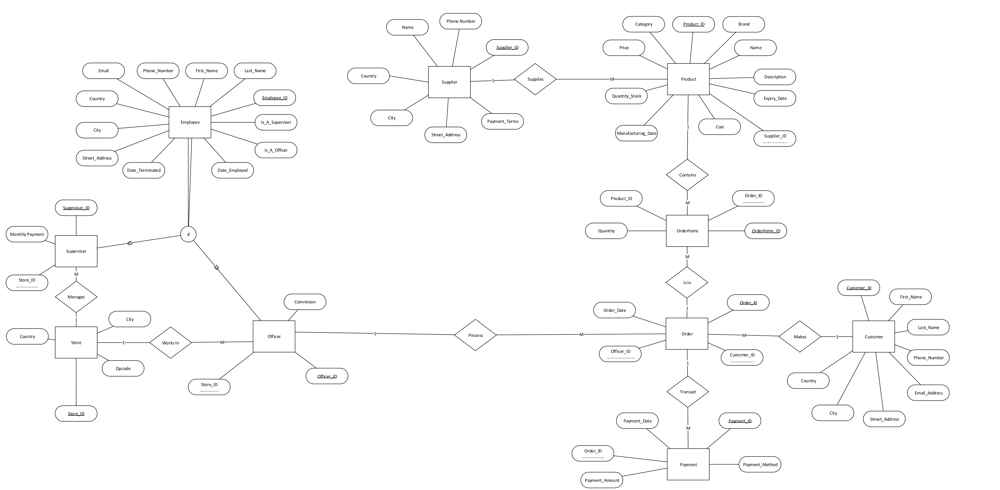

# GlowUP Retail: From Operational Database to an OLAP Cube

Turning a retail beauty store's Microsoft Access operational database into a star-schema business-intelligence model with an OLAP cube for sales analysis.

## Business problem
GlowUP is a retail beauty store in sub-Saharan Africa. Its operational database runs day-to-day trading, but the Sales Department could not easily answer questions such as:
- What revenue did each product generate this year?
- How does selling cost vary across store locations?
- Which officer earned the most commission?
- What is the profit margin per store?

## What I built
- **Star schema** with a `Sales Fact` table (quantity, price, revenue, profit, selling cost, commission) and **Product, Customer, Officer, Store and Time dimensions**, created with SQL queries in Access.
- A custom **Time dimension** (year, quarter, month, week, day, day of week) built in Excel and imported.
- An **OLAP cube** (`.cub`) with drill-down hierarchies, for slicing by dimension, measure and filter.
- Written design decisions and an evaluation (what went well, what didn't, what I'd do differently).

## Repository contents
| Path | What it is |
|---|---|
| `docs/project-writeup.pdf` | Full write-up: requirements, dimension/fact design decisions, evaluation |
| `docs/project-presentation.pptx` | Presentation deck |
| `docs/erd.pdf` | Entity-relationship diagram of the operational database |
| `data/slicer-ddl.txt` | Cube definition (measures, dimensions, levels) |
| `data/time-dimension.xlsx` | Time dimension source |
| `data/project-data.xlsx` | Project data extract |
| `workbooks/retail-cube.cub` | The OLAP cube file |

The full Access database (`Retail_WarehouseBI.accdb`, about 38 MB) is attached to the [Releases](../../releases) page.

## Tools
Microsoft Access, SQL, Excel, OLAP cubes, dimensional modelling (star schema).

## Notes
The data is sample/dummy data created for coursework. This project was completed as part of my MS coursework at SPU (Business Intelligence and Knowledge Management).

## License
MIT, see [LICENSE](LICENSE).
